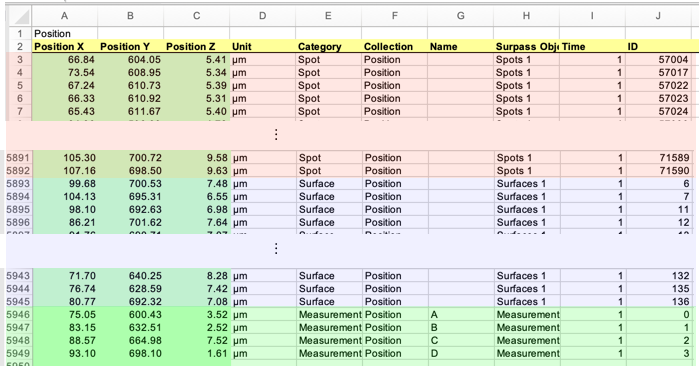
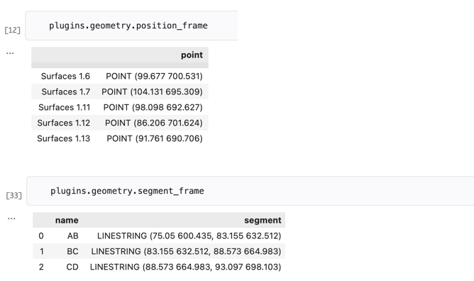
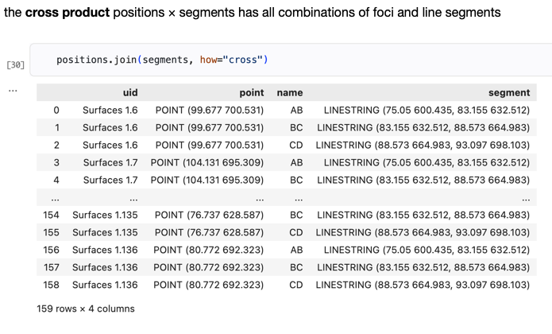
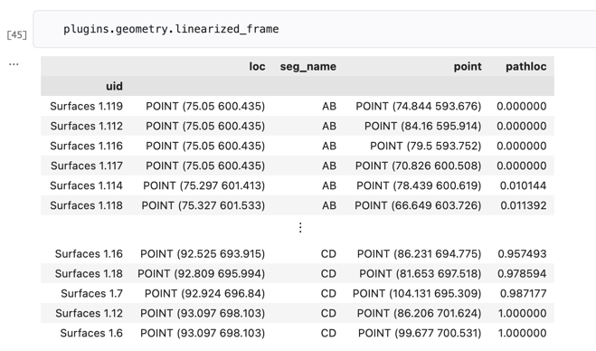

# Geometry

All of the "heavy lifting" of the linearization pipeline is done in the Geometry module.

The data used by this module is typically on a sheet named "Positions", such as this one from an example data set:



There are three different groupings in this sheet.
The first set of rows (highlighted in red) have "Spot" in the Category column.
The next group (highlighted in blue) has "Surface" in the Category column, and the last group (highlighted in green) has "MeasurementPoint".

For this project we want the plugin to ignore the spots, make a data point for each surface, and combine adjacent measurement points into line segments.

## Plugin Configurations

The attributes that can be assigned in the `geometry` section of the configuration are listed in this table:

| Attribute | Default | Note |
| -- | -- | -- |
| `sheet_name` | `Position` | |
| `category_column` | `Category` | name of column with category values |
| `x_coord` | `Position X` | |
| `x_coord` | `Position Y` | |

The attributes that can be specified in `geometry.foci`:

| Attribute | Default | Note |
| -- | -- | -- |
| `category` | `'Surface'` | |
| `index` | `['Surpass Object','ID']` | columns are concatenated to form data point IDs |

The attributes that can be specified in `geometry.measurements`:

| Attribute | Default | Note |
| -- | -- | -- |
| `category` | `'MeasurementPoint'` | |
| `index` | `Name` | |

**Note:** The `geometry.foci` and `geometry.measurements` sections "inherit" all of the attributes listed in the `geometry` section shown above.
If a project has foci or measurements on different sheets or attributes in different columns those attributes can be overridden in these sections.

#### Example

The configuration section for the example uses all of the default values, so it only has to name the plugins:

```
[geometry]
[geometry.foci]
[geometry.measurements]
```

Here are the resulting frames after the data is read from the spreadsheet:



## Linearization Algorithm

The first step in the linearization algorithm is to compute all possible distances.
We can start this process by making a table that has every combination of data point and line segment using an operation called the "cross product".



The next steps are:

- compute the distances and add them to the cross product frame.
- group the rows by IDs
- find the minimum distance in each group

The final result is a data frame that has one row for each nucleus.
In that row are the name of the nearest line segment, the point where a line from the nucleus intersects the line segment, and the total length of a path from the first measurement point up to the intersection point.



## API

The Geometry plugin is accessed via the [Plugin Manager](manager.md).

#### Attributes

`plugins.geometry`

:   A reference to the Geometry plugin.

`plugins.geometry.foci`

:   A reference to the Foci plugin.

`plugins.geometry.measurements`

:   A reference to the Measurements plugin.

`plugins.geometry.position_frame`

:   A Pandas DataFrame with the locations of the foci read from the Imaris spreadsheeet.  The frame has the following columns:

   - index: a unique ID formed by concatenating the columns defined in the `id_cols` settings in the configuration

   - `point`:  a GeoPandas POINT object with the coordinates of the data point.

`plugins.geometry.measurement_frame`

:   A Pandas DataFrame the locations of the measurement points read from the Imaris spreadsheeet.  The frame has the following columns:

    - index: the name of the measurement point

   - `point`:  a GeoPandas POINT object with the coordinates of the measurement point.

`plugins.geometry.segment_frame`

:   A Pandas DataFrame with descriptions of line segments formed by connecting adjacent measurement points.  The frame has the following columns:

    - index:  the name of the line segment, formed by concatenating two measurement point IDs

    - `head`: the point at the start of the segment

    - `tail`: the point at the end of the segment

    - `segment`: a GeoPandas LINESTRING object with the head and tail of the segment

    - `orientation`:  a string (NW, NE, SE, SW) intended to be used by visualizaation algorithms

    - `A` and `C`: parameters of the linear equation of the segment

    - `length`: the length of the segment

    - `pathlen`: the sum of distances from the start of the first segment to the start of this segment

`plugins.geometry.linearized_frame`

:   A Pandas DataFrame with the output of the linearization algorithm.  The frame has the following columns:

    - index: the name of a data point

    - `seg_name`: the ID of the line segment closest to the point

    - `point`: the coordinates of the data point

    - `head`: the of the closest line segment

    - `tail`: the tail of the closest line segment

    - `distance`: the distance from the data point to the line segment

    - `loc`: the point on the segment that is closest to the data point

    - `orientation`: a string (NW, NE, SE, SW) intended to be used by visualizaation algorithms

    - `pathlen`: the sum of distances from the start of the first segment to the start of the segments closest to the point

    - `pathseg`: the distance from the start of the segment to the location where a line from the data point intersects the segment

    - `pathloc`: the normalized distance from the start of the first segment to the location where the data point intersects the segment

#### Methods

`plugins.geometry.apply(xls_file)`

:   Read the positions of foci and measurments from an open XLS file.

`plugins.geometry.linearize()`

:   Execute the linearization algorithm.  If a Measurement plugin is configured
    the output is a frame that has the closest line segment to each data point,
    otherwise the output is just a referencee to the positions of the points.
    
