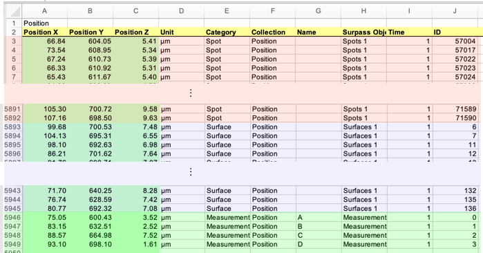
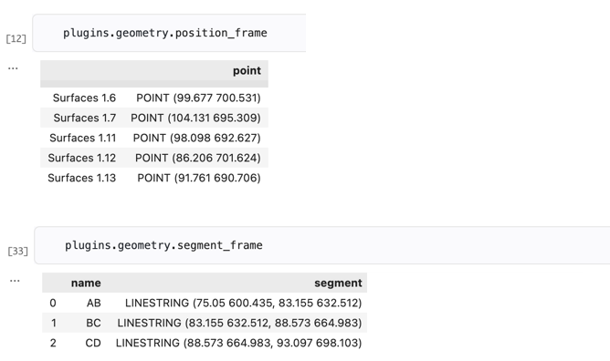
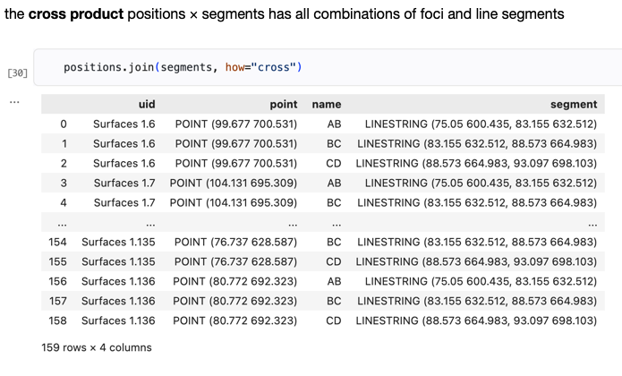
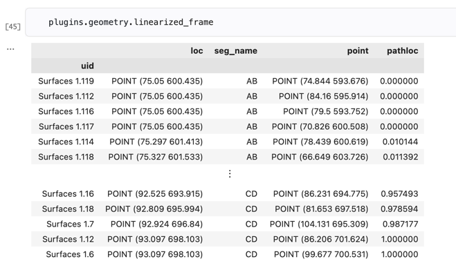

## Linearization

All of the "heavy lifting" of the linearization pipeline is done in the Geometry module.

### Input Data

The data used by this module is typically on a sheet named "Positions", such as this one from an example data set:



There three different groupings in this sheet.
The first set of rows (highlighted in red) have "Spot" in the Category column.
The next group (highlighted in blue) has "Surface" in the Category column, and the last group (highlighted in green) has "MeasurementPoint".

The first thing the Geometry plugin does is to separate out the rows.
In this example, it's going to ignore the spots, save the surfaces in a Pandas data frame, and save the measurements in a third frame.

The plugin gets its instructions from the config file; for this project it looks like this:

```
[geometry]
sheet_name = 'Position'
category_column = 'Category'

[geometry.foci]
category = 'Surface'
index = ['Surpass Object','ID']

[geometry.measurements]
category = 'MeasurementPoint'
index = 'Name'
```

The first section tells the plugin where to get the position data for both frames:  it's on the sheet named "Position", and it should look in the Category column when deciding which rows to use.
The next two sections tell the plugin to make a data frame for foci from the rows that have "Surface" in the Category column and to make a frame for measurements using rows with "MeasurementPoint" in the Category column.

After the measurements are saved the plugin makes one more frame.
This one has line segments formed by connecting adjacent measurement points.
Here are the resuling frames that will be used in subsequent steps:



### Algorithm

The key step in the linearization algorithm is to compute all possible distances.
We can do this by making a table that has every combination of data point and line segment:



The next steps are:

- compute the distances and add them to the cross product frame.
- group the rows by IDs
- find the minimum distance in each group

The final result is a data frame that has one row for each nucleus.
In that row are the name of the nearest line segment, the point where a line from the nucleus intersects the line segment, and the total length of a path from the first measurement point up to the intersection point.


