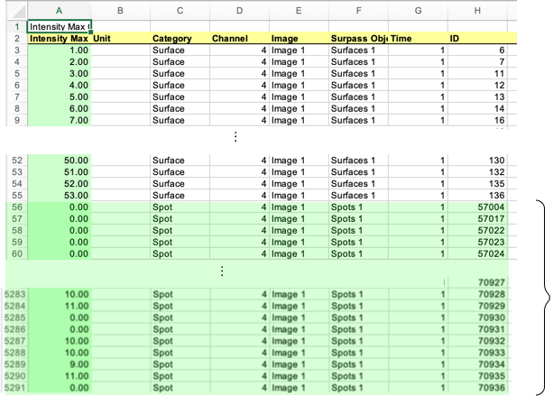
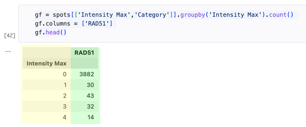
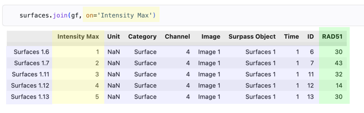

## Counting Spots

The Group stage summarizes the data in one of the sheets to produce counts.
The process is best explained using a sheet from one of the example data sets.

### Input Data

A sheet named "Intensity Max Ch=4 Img=1" has a table that connects spots to surfaces.
This is what the sheet looks like in Excel:



There are two parts to the table. 
The upper part has the word "Surface" in the Category column, and the lower part (shaded in green) has "Spot" in that column.

The essential thing to know about this table is that unlike most other sheets, the leftmost column, labeled "Intensity Max", does not actually contain intensity values.
Those numbers are IDs.
For the surface rows IDs are numbers ranging from 1 to 53, which is the number of surfaces in the data set.

For the spots, the number in the left column is the ID of the surface that (according to Imaris) the spot is closest to.
Most spots have a 0 in this column, which means the spot is not associated with any surface.
But you can see at the bottom of the figure, in row 5283, there is a 10 in the leftmost column, which means this spot is closest to surface number 10.
Other spots below that have 9, 10, or 11 in the leftmost column, meaning they are close to surfaces with those IDs.

### Algorithm

The Group stage gets its name from `groupby`, the Pandas operation that summarizes the data and produces the counts.
The main steps in this plugin are:

1. Split the sheet into two parts and make two data frames, one for surfaces and one for spots

1. Group the spots according to their IDs, and count the number of rows in each group; note that the name of each group is the ID of one of the surfaces

1. Append the counts to the end of the surfaces frame using a join operation that connects counts to surfaces using the ID column

Here is what the group operation looks like:



Note that the first row is the count of the number of spots that have 0 in the "Intensity Max" column.
This count is ignored when the counts are joined with the surfaces.

The result of that join is shown below.
The yellow shading highlights the fact that the join is using the column named "Intensity Max" and that this column appears in both the spots and surfaces frames.



### Configuring the Group Plugin

This grouping operation can be generalized to apply to other data sets, as well.
The configuration section for the plugin needs to specify the name of the sheet to use, the names of the columns that divide the sheet into the main data and the rows to use for groups, and the name of the output column.

This is the configuration section that was used for the example data shown above:

```
[group.intensity]
sheet = 'Intensity Max Ch=4 Img=1'
category_column = 'Category'
category = 'Surface'
group = 'Spot'
column = 'Intensity Max'
aggregation_function = 'count'
aggregation_name = 'RAD51'
```

The full details of all of the options and their default values is in the documentation of the [Group Plugin](group.md).
