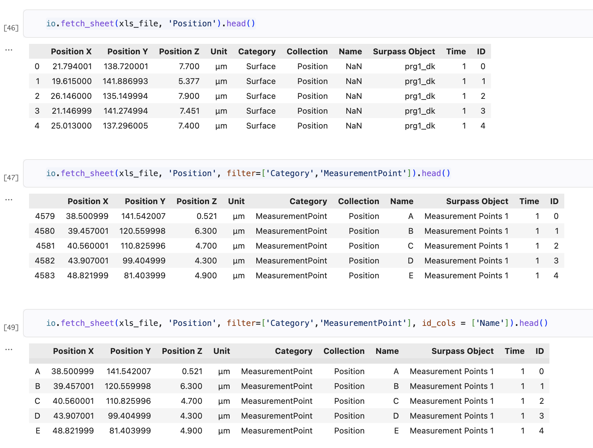

# IO

GAWP's `io` module defines the IO plugin and several functions that can be called from notebooks that do not need to use the plugin itself.

## Plugin Configuration

The section name to use when configuring the IO plugin is `[io]`.
The configuration option are listed in the table below.

| Option | Default | Description |
| -- | -- | -- |
|`spreadsheets` | `''` | The name(s) of Imaris spreadsheets to analyze |
|`output_dir` | `''` | Directory for output files |
|`output_name` | `''` | A pattern to use for output files |
|`log` | `''` | The name of a file for log messages |

#### `spreadsheets`

The value of the `spreadsheets` option can be a single file name or a name pattern containing wildcards.

Name patterns have the same syntax used in shell commands, _i.e._ they can use question marks and asterisks as wild cards.
If the name is a pattern it is expanded and the script will process all of the files that match the pattern.

File names are relative to the directory where the script is run.
For example, the pattern `"../data/*"` means "all files in a folder named `data` in the directory above the current working directory."

#### `output_dir`

This is the name of a directory where output files will be written.
As with spreadsheet names, the name is relative to the current directory.

#### `output_name`

This parameter is a pattern to use for output files.

When writing a pattern, the string `"{fn}"` will be replaced by the name of the current input file.
For example, suppose a directory named `data` has three spreadsheets named `a.xls`, `b.xls`, and `c.xls`.
The configuration would have `"data/*"` for `spreadsheets`.
The pattern `"linear_{fn}"` would tell GAWP to write the outputs to `linear_a.xls`m `linear_b.xls`, and `linear.c.xls`.

#### `log`

> Not implemented yet.

#### Example

Ths configuration tells GAWP to process every spreadsheet (a file ending with `.xlsx`) in a directory named `data`.
The script will create a directory named `output` in the folder where the script is run,
and ouput files will have the same name as input files but with the word "linearized" added to the front of the name.

```
[io]
spreadsheets = 'data/*.xlsx'
output_dir = './output'
output_name = 'linearized_{fn.stem}'
```

## `open_spreadsheet`

Call this function to open an Excel spreadsheet.

There is only one parameter, the name of the file to open.
The value returned is an ExcelFile object that can be passed to `fetch_sheet` to read data from the spreadsheet.

The function works with either older style `.xls` files or the newer `.xlsx` format.

## `fetch_sheet`

Call `fetch_sheet` to read a sheet of data from an Excel file.
The data will be return as a Pandas DataFrame object.

The first argument passed in the call must be an ExcelFile object created by calling `open_spreadsheet`.
The second must be the name of the sheet to read the data from.

There are two additional arguments that can be passed:

- `id_cols` is a list of one or more column names.  If no column names are passed the index
will be the integers starting from 0 (the default RangeIndex in Pandas).  If column names 
are passed, the function will concatenate the values in those columns to create the index.

- `filter_cols` will select a subset of the rows from the sheet.  Pass a list of two items:
the name of a column and a value to filter by.  The output frame will contain only the
rows where this value is found in the column.

#### Example


