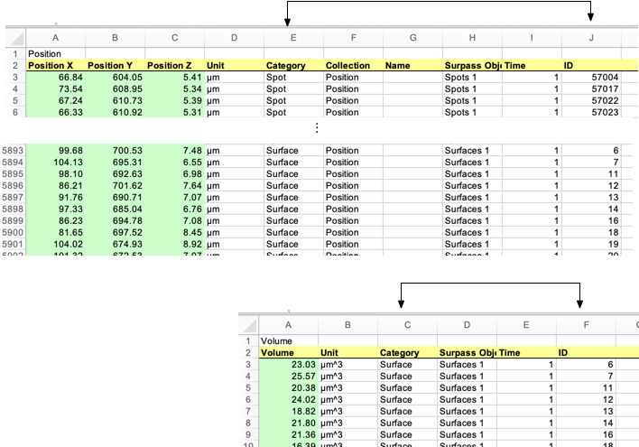

# Join

The Join stage copies data without modifying it and saves it in a table that can be combined with results from other plugins.
The configuration file specifies which sheets have the data and which columns on those sheets to copy.

The name "join" comes from relational databases, where the concept originated.
It is now standard terminology in R, Pandas, and other data science libraries that work with tabular data.
The tables created by the Join plugin have names for data points that are compatible with the names assigned by other plugins.
Typically this is a name formed by combining the Category and ID columns in each table.
A join operation makes sure rows with matching IDs are aligned with each other.




## Plugin Configuration

The configuration section that adds a Join plugin should have a name consisting of the word "join", a period, and a name.
Within each section define the attributes to use for that plugin:

| Attribute | Default | Note |
| -- | -- | -- |
| `sheet` | (required) | name of the sheet with data to join |
| `column` | (required) | column that contains the data to copy |
| `category_column` | `''` | column for filtering rows |
| `category` | `''` | value for filtering rows |
| `index` | `''` | names of columns for creating IDs |

The first two attributes are required.  If the remaining attributes are left out they are copied from the Geometry plugin.

#### Example

This configuration copies data from the Volume and Sphericity sheets, using the default column names for IDs.

```
[join.volume]
sheet = 'Volume'
column = 'Volume'

[join.sphericity]
sheet = 'Sphericity'
column = 'Sphericity'
```

## API

The Join plugins are accessed via the [Plugin Manager](manager.md).

#### Attributes

`plugins.join`

:   A reference to the top level Join plugin, which maintains a list of objects, one for each column to copy.

`plugins.join.sheets`

:   A list of JoinSheet objects, each of which has specifications for copying one column.

`plugins.join.combined_frame`

:   A Pandas DataFrame created by the `apply` method.  It has one column for each sheet copied.

#### Methods

`plugins.join.apply()`

:   Iterates over all sheets, extracting the data and saving it in the output frame.

