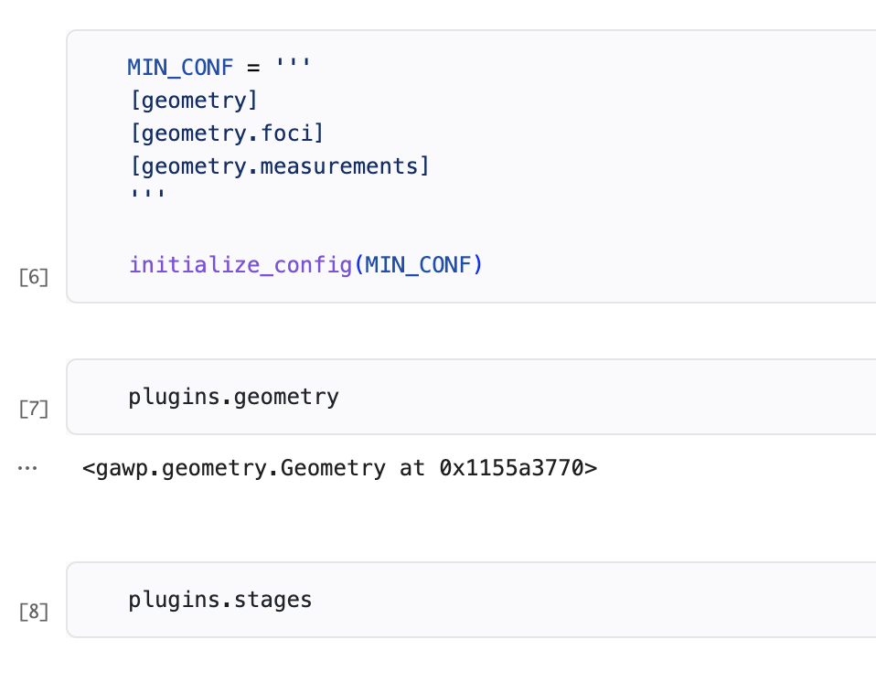
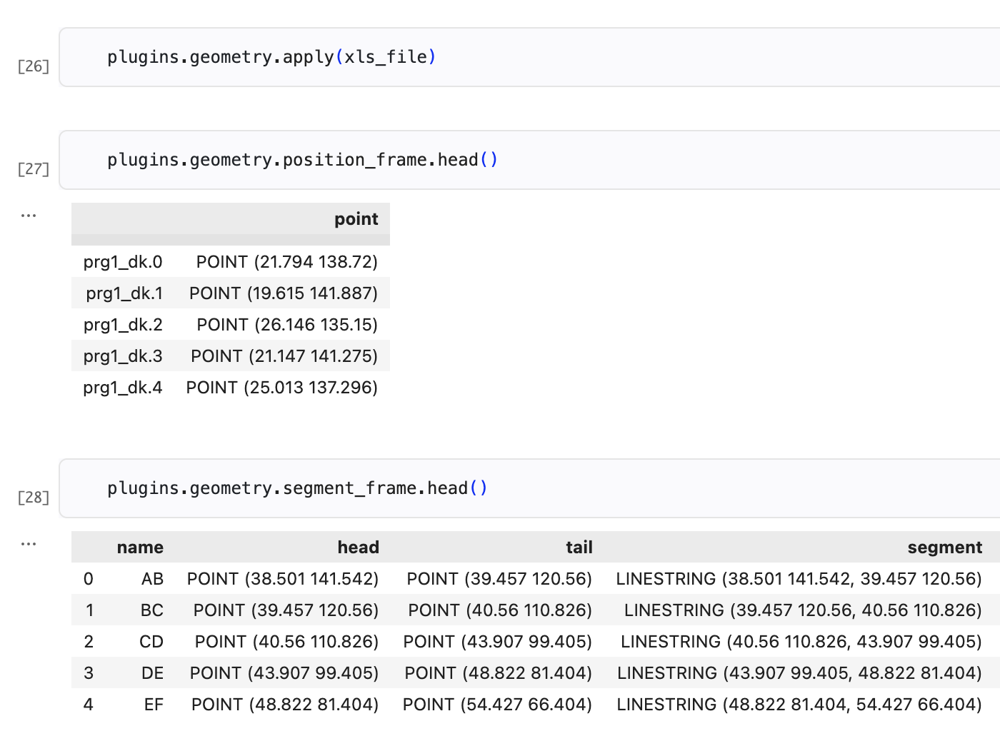

# Using Plugins in An Application

When the `initialize_config` function creates the plugins requested in a configuration file it registers them with a module called the **plugin manager**.
Applications use the manager to figure out which plugins are installed, to run the plugins, and to access their outputs when they have finished.

The module is named `plugins`.
To use it, import it into your application:

```
from gawp.plugin import plugins
```

## Accessing Plugins

After the module is imported you can refer to the plugins by name, _e.g._ `plugins.geometry` or `plugins.stages`.
These names are all defined when GAWP is first imported, but they are all set to `None`.
After you call `initialize_config` the names are updated and will be references to the objects that implement the stage.

In this example, a notebook defines a workflow that only has the three geometry plugins, so `plugins.stages` is still None
after the setup.



## Running Plugins

To execute the part of the workflow defined by a plugin call one or more methods defined in the plugin's module.
For example, the Geometry plugin has a method named `apply`.
It reads the positions of the foci and (if Measurements is installed) the positions of the measurement points, saving them in data frames that can be accessed later.



The sections below have a brief overview of the plugins and methods that are most likely to be used in a Jupyter notebook.
For more details see the complete documentation at [Plugin Manager](manager.md).

### Geometry

`plugins.geometry.apply(xls_file)`

:   Read the positions of foci and (if configured) measurments from an open XLS file.

    Saves the results in `plugins.geometry.position_frame` and `plugins.geometry.measurement_frame`.

`plugins.geometry.linearize()`

:   Execute the linearization algorithm.  Returns a Pandas DataFrame, indexd by data
    point ID, containing the name of the closest line segment and coordinates of
    the where a line from the point intersects the segment.  
    
    The data frame is also saved as `plugins.geometry.linearized_frame`.

### Join

`plugins.join.apply(xls_file)`

:   Create a Pandas DataFrame that has one column of output for each sheet specified in the
    configuration file.

    The data frame is also saved as `plugins.join.combined_frame`.

### Group

`plugins.group.apply(xls_file)`

:   Create a Pandas DataFrame that has one column of output for each sheet specified in the
    configuration file.

    The data frame is also saved as `plugins.join.grouped_frame`.

### Stages

`plugins.stages.apply(fn, df)`

:   The arguments are the name `fn` of the spreadsheet `fn` and a frame `df` that is
    indexed by data point ID and has the name of the line segment closest to the
    point.  Look up the stage breaks for the file and create a Pandas DataFrame
    that has the meiotic stage for each point.

    The result is also saved as `plugins.stages.stage_frame`

Note: The names of segments are in the frame created by the Geometry plugin, in a
column named `seg_name`.  This is how the main loop in the command line application
calls `stages.apply`:

```
plugins.stages.apply(fn, plugins.geometry.linearized_frame[['seg_name']])
```
