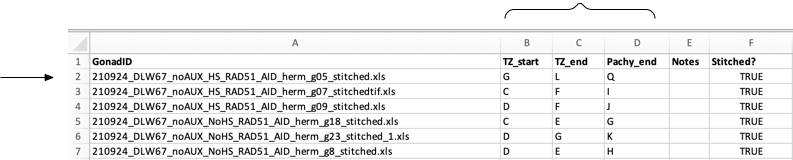
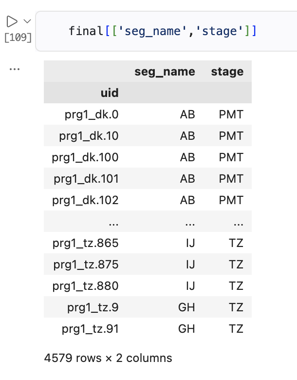

# Stages

The data for adding transitions between meiotic stages is kept in a separate spreadsheet from the data exported by Imaris.

This extra spreadsheet has one row for every data set.
The leftmost column has the names of Imaris spreadsheets.
Next to that are columns for transitions between stages and additional notes.

The Stages plugin creates a new column to add to the final output.
For each data point the plugin uses the ID of the closest line segment (now saved in the `seg_name` column of the linearized data frame) to assign the meiotic stage according to the measurement points in the stage table.

## Plugin Configuration

The attributes that can be assigned in the `stages` section of the configuration are listed in this table:

| Attribute | Default | Note |
| -- | -- | -- |
| `file` | (required) | name of the XLS file with stage transitions |
| `index` | `'GonadID'` | the name of the column with file names |
| `filter_column` | `'Stitched?'` | name of a column to filter rows |
| `filter` | `'TRUE'` | use rows that have this value in the filter column |
| `stage_columns` | `['TZ_start','TZ_end','Pachy_end']` | the names of the columns with stage transitions |
| `stage_names` | `['PMT', 'TZ', 'PACH'` | the names to use in the output |

#### Example

Here is part of the output for the example data:

The plugin looked in columns named `TZ_start`, `TZ_end`, and `Pachy_end` to find the transitions.
For example, since `TZ_start` is `G` for this data set, all rows in the linearized frame that have a segment that starts before `G` are assigned `PMT` (the output name for this stage).
All rows that have segments between `G` and `L` are assigned `TZ`, and so on.

**Note:** The plugin does not make any assumptions about names of stages or how many stages there are.
As long as the number of column names matches the number of stage names the names will be assigned.

## API

The Stages plugin is accessed via the [Plugin Manager](manager.md).

#### Attributes

`plugins.stages`

:   A reference to the Stages plugin.

`plugins.stages.boundaries`

:   A Pandas DataFrame based on the contents of the stage transitions spreadsheet, containing one row per data set.

`plugins.stages.stage_frame`

:   A Pandas DataFrame created by the `apply` method.  It will have the same number of rows and same index as the
    segments frame passed to `apply`, and one column with assigned stage names.

#### Methods

`plugins.stages.read_stage_boundaries()`

:   Opens the XLS file containing stage transitions (using the file name from the configuration), saves the contents as a Pandas DataFrame.

`plugins.group.apply(fn, segments)`

:   Assign meiotic stage names to each data point.  `fn` is the name of a data set (the name of the file used to find stage names in the stage transitions table).
    `segments` is a frame with segment names, indexed by data point ID.
    The output will have the same number of rows, and a column with 

