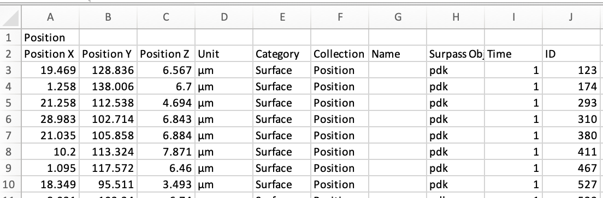
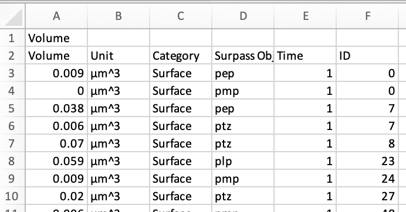

## Join

The next plugin to add to the workflow is called **Join**.
The goal is to find a column of data from one of the other sheets and append it to the dataframe that will be saved at the end of the workflow.

The name "join" comes from the relational database world.
When the new column is added, the script can't simply copy and paste the column from the other sheet because the rows might not be in the same order as the foci in the Position sheet.
Instead, to make sure the data is aligned properly, the script has to use an item's ID from one sheet and connect it with an item with the same ID in the other sheet.

The configuration file has to tell the script how to make a unique identifier for each data point.
In the test data, the IDs are made by concatenating strings from the "Surpass Object" and "ID" columns.

As an example, here are the first few rows of the Position sheet for the first data file (`herm_5.xslx`):



The IDs made by the script become the index values in the data frame.
The name of the index is `uid` (for "unique identifier") and it is displayed in the leftmost column when the frame is printed on the terminal:

```
Preview for herm_5:
        seg_name                   point                    head                   tail ...
uid                                                                                                                                                                    
pdk.123       AB  POINT (19.469 128.836)  POINT (38.501 141.542)  POINT (39.457 120.56) ...
pdk.174       AB   POINT (1.258 138.006)  POINT (38.501 141.542)  POINT (39.457 120.56) ...
...
```

Now suppose we want to add the "Volume" column from the sheet of the same name to the output.
This is the sheet as its shown in Excel:



Note it has the same "Surpass Object" and "ID" columns, but the rows are not in the same order.
This sheet is orderd by ID, so rows with smaller numbers in that column are at the top of the sheet.
The Position sheet is ordered by Surpass Object, so rows with "pdk" appear first, then rows with "pek", and so on.
But if we concatenate the strings to make unique IDs we can match objects in one sheet with objects in the other sheet.

Let's add two Join plugins in the workflow, one for volume and one for sphericity.
Add these lines to your configuration file:

```
[join.volume]
sheet = 'Volume'
column = 'Volume'
index = ['Surpass Object','ID']

[join.sphericity]
sheet = 'Sphericity'
column = 'Sphericity'
index = ['Surpass Object','ID']
```

Note how the section names have the word "join" followed by a period and another name.
If we just used the word "join" by itself we would have two sections with the same name, but TOML doesn't allow that, so we have to add those qualifiers.

In both of these new sections we specify the name of the sheet in the XLS file that has the data we want to copy, the name of the column on that sheet (which just happens to be the same name), and the names of the columns to use when forming the unique identifiers.

After you add those sections to your config file and run the script again you'll see the new columns at the end of the output:

```
$ gawp --log quiet run --preview

Preview for herm_5:
        seg_name                   point  ...     pathlen    pathseg   pathloc  Volume  Sphericity
uid
pdk.123       AB  POINT (19.469 128.836)  ...    0.000000  11.826586  0.049429   0.017       0.731
pdk.174       AB   POINT (1.258 138.006)  ...    0.000000   1.837206  0.007679   0.001       0.561
...

Preview for herm_7:
        seg_name                   point  ...     pathlen    pathseg   pathloc  Volume  Sphericity
uid
pep.217       FG  POINT (120.258 57.426)  ...  188.943937   4.008221  0.729937   0.000       0.634
pep.263       FG  POINT (115.396 57.698)  ...  188.943937   8.551765  0.747126   0.000       0.729
...

Preview for herm_9:
        seg_name                    point   ...     pathlen    pathseg   pathloc  Volume  Sphericity
uid
pdk.148       IJ     POINT (54.723 37.05)   ...  197.050149  13.864763  0.989445   0.013       0.733
pdk.149       IJ    POINT (58.296 33.857)   ...  197.050149  12.331072  0.982250   0.002       0.671
...
```
